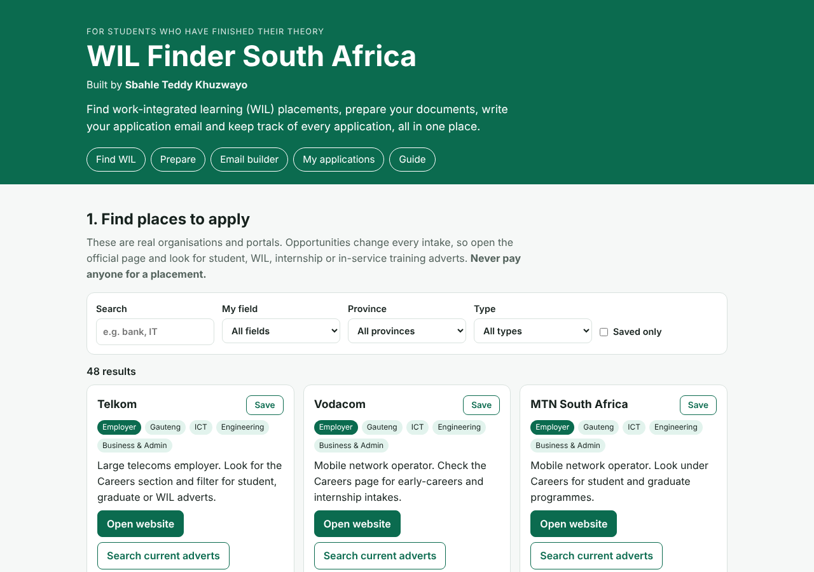
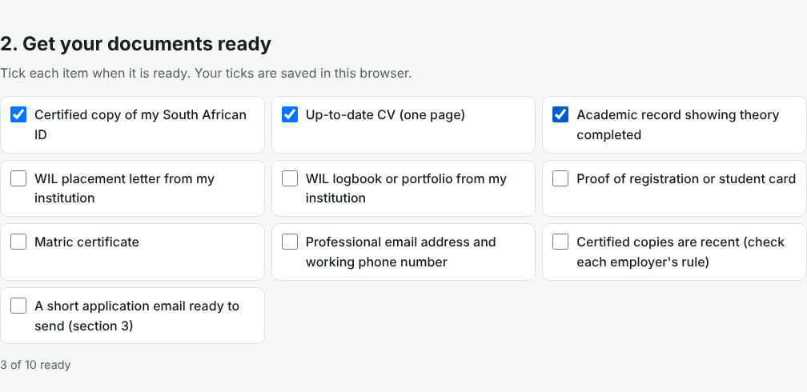
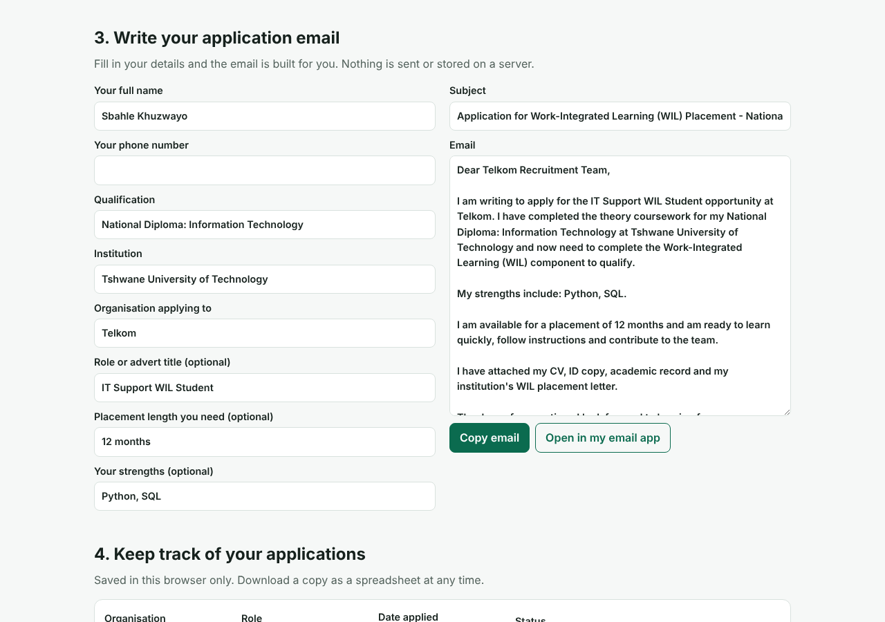
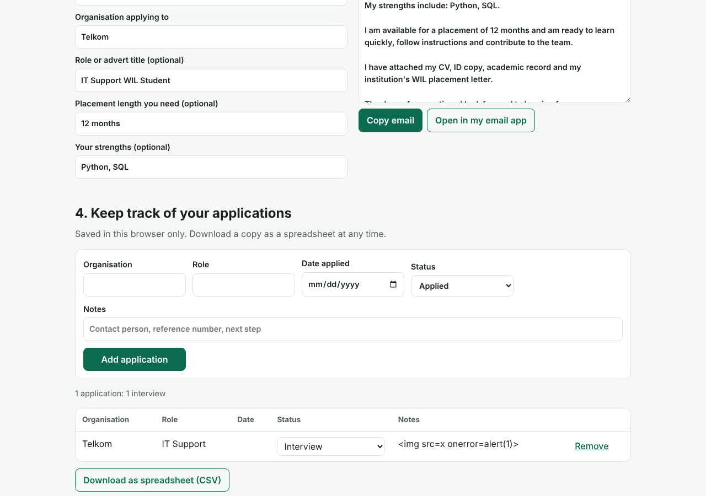
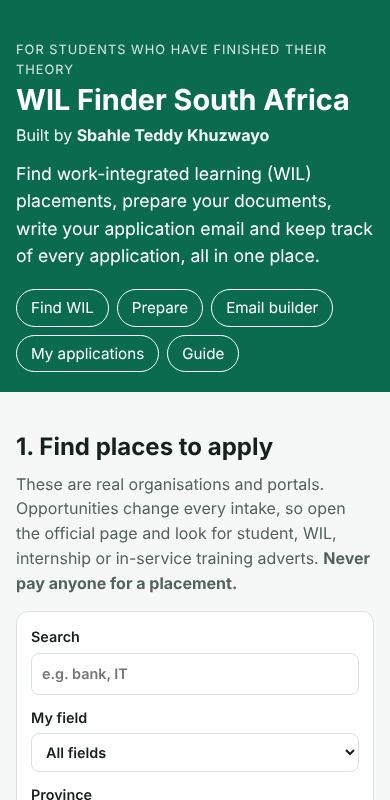

# WIL Finder South Africa

**Work-Integrated Learning Opportunity Directory and Application Toolkit**

A free website that helps South African students find a work-integrated learning (WIL) placement after they have finished their theory coursework.

Many students finish their classes and then do not know where to look, what documents they need, or how to keep track of their applications. This site puts all of that in one place. It runs in the browser, needs no sign-up and stores nothing on a server.

**Author:** Sbahle Teddy Khuzwayo  
**Contact:** sbahlekhuz2000@gmail.com

## What it does

| Feature | What it helps with |
|---|---|
| **Directory of 48 organisations** | Search and filter employers, public-sector bodies, SETAs and job boards by field, province and type. Each card links to the organisation's own website and to a search for its current adverts. |
| **Document checklist** | Tick off the documents most employers ask for. Progress is remembered. |
| **Email builder** | Type your details once and get a ready-to-send application email with a subject line. Copy it or open it in your email app. |
| **Application tracker** | Record every application, update its status (Applied, Interview, Offer, Placed) and download the list as a spreadsheet. |
| **Guide** | Plain-language answers about what WIL is, how to stand out, and how to avoid placement scams. |

## Screenshots

**Home and directory**



**Document checklist**



**Email builder**



**Application tracker**



**On a phone**



## How to run it

No installation is needed.

1. Download or clone this repository.
2. Open `index.html` in your browser (double-click it).

Or in VS Code: install the **Live Server** extension, right-click `index.html` and choose **Open with Live Server**.

## How to put it online (free)

1. Push this project to a GitHub repository.
2. Go to **Settings > Pages**.
3. Under **Branch**, choose `main` and `/ (root)`, then **Save**.
4. After a minute your site is live at `https://<your-username>.github.io/<repository-name>/`.

## How to add an organisation

Open `js/data.js` and copy one line inside the list. Change the name, type, province, fields, link and note. Save and refresh the page.

## Tests

The search, filter, email and spreadsheet logic is tested with Node.js:

```
node tests/test_logic.js
```

The tests check that every directory entry is complete and uses an `https` link, that filters behave correctly (including that national organisations show in every province), that the email is built correctly with and without details, and that the spreadsheet download cannot be used to run spreadsheet formulas.

## Honest limits

- The directory links to organisations' **own websites**. It does **not** list live vacancies and does not claim any organisation has a placement open right now. Students must open the official page and check.
- Province means the organisation's head office. Many employers place students in other provinces.
- Eskom's recruitment website was marked as temporarily unavailable when this directory was built. Confirm it is back before relying on it.
- Your tracker, ticks and email details are saved in your own browser only. Clearing your browser data removes them.
- This is a student project. It is not affiliated with any organisation listed.

## Built with

HTML, CSS and plain JavaScript (no frameworks, no build step). Works on phones and in light and dark mode. Keyboard accessible, with labelled form fields and visible focus.

## Project structure

```
index.html          the page
css/styles.css      the design
js/data.js          the directory (edit this to add organisations)
js/logic.js         search, filter, email and CSV functions (tested)
js/app.js           connects the logic to the page
tests/test_logic.js automated tests
screenshots/        images used in this README
```

## Author

Designed and built by **Sbahle Teddy Khuzwayo**, 2026.
